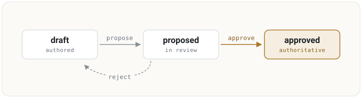

<div align="center">

<h1>OKGF</h1>

<h3><em>Open Knowledge and Governance Format</em></h3>

<p><strong>Portable knowledge, with portable trust. A vendor-neutral format that lets AI agents and teams share knowledge they can actually rely on: scoped, reviewed, sourced, and cryptographically verifiable, all in plain markdown.</strong></p>

<p>
  <a href="LICENSE"></a>
  <a href="SPEC.md"></a>
  <a href="https://onehill.org/okgf"></a>
  <a href="https://onehill.org"></a>
</p>

</div>

---

An AI agent is only as good as the knowledge it can trust. OKGF takes the plain-markdown wiki your agents
already read and adds the half that matters when knowledge is shared or shipped: **who approved this, how
good it is, where it came from, and proof it was not tampered with.** It is a strict **superset of Google
Cloud's [OKF](https://github.com/GoogleCloudPlatform/knowledge-catalog/tree/main/okf)**, which formalises
Andrej Karpathy's [LLM Wiki](https://gist.github.com/karpathy/442a6bf555914893e9891c11519de94f) pattern, so
every OKGF bundle is still a valid OKF bundle. OKF-only tools read it and ignore the governance.

A reference implementation that uses OKGF as its native on-disk format, with review-gated export and import,
is coming soon.

## Table of Contents

- [Why OKGF exists](#why-okgf-exists)
- [How it works](#how-it-works)
- [The review lifecycle](#the-review-lifecycle)
- [Get started](#get-started)
- [Run a store](#run-a-store)
- [What's here](#whats-here)
- [Lineage](#lineage)
- [Status](#status) · [Contributing](#contributing) · [License](#license)

## Why OKGF exists

OKF makes knowledge **portable**: markdown plus YAML frontmatter, human- and agent-readable, diffable in
git, no central registry. It deliberately stops at the format and defines no review, approval, or trust
model. That is the right choice for casual notes.

But most knowledge that matters is **load-bearing**. An agent acts on it. It feeds a decision, a customer
answer, or a training set. It is shared across teams or shipped to customers. For that knowledge you have to
be able to answer four questions:

- **Who approved this, and for what scope?** My personal draft, or the org's authoritative position?
- **How good is it?** Curated and verified, or unreviewed?
- **Where did it come from?** What sources back the claim?
- **Can I prove it was not tampered with?** Really approved by the org, or edited in transit?

If every tool answers those in its own private database, the trust context lives *outside* the file and is
lost the instant you export it. That is a vendor format again, just a subtler one. OKGF puts the answers
**in** the file, so trust travels with the knowledge. That is the difference between portable text and
**portable trust**.

## How it works

An OKGF bundle **is** an OKF bundle: a directory of markdown files with YAML frontmatter, linked into a
graph. OKGF adds five optional fields under the reserved `x-okgf-*` namespace. Every field is optional, a
page that omits them is still valid, and any OKF-only tool round-trips them untouched.

```yaml
---
type: Concept
title: Billing model
description: We bill monthly per seat.
timestamp: '2026-07-02T09:15:00+00:00'
x-okgf-scope: org           # whose knowledge
x-okgf-review: approved     # authoritative, not a draft
x-okgf-tier: gold           # curated and verified
x-okgf-sources:             # provenance
- https://stripe.com/docs/billing
x-okgf-signature: lbTP5Er...  # Ed25519, verifiable out of band
---
# Billing model

We bill monthly per seat.
```

| Field | Values | Meaning |
| --- | --- | --- |
| `x-okgf-scope` | personal / team / org | Which plane the page belongs to. `org` is the shared, authoritative set. |
| `x-okgf-review` | draft / proposed / approved | Lifecycle state. Authoritative only when `approved`. |
| `x-okgf-tier` | bronze / silver / gold | Quality rating for downstream use, such as training-data selection. |
| `x-okgf-sources` | list of URIs | Where the knowledge came from. |
| `x-okgf-signature` | base64 Ed25519 | Signs an approved promotion so it can be verified against a published key. |

## The review lifecycle

Knowledge earns authority. A page starts as a `draft`, is `proposed` for review, and becomes `approved`
only when a human reviewer accepts it. Promotion into a shared scope passes through `proposed`, and a
rejected page returns to `draft`. A consumer treats **only `approved` pages as authoritative** and may
surface the rest as candidates.



An approved promotion to a shared scope **may be signed** (Ed25519 over the canonical page). The verifying
key is published out of band, so anyone can confirm the org really approved it, offline. See
[`SPEC.md`](SPEC.md) for the exact rules.

## Get started

Validate a bundle with the reference validator (Python plus PyYAML):

```sh
python tools/okgf_validate.py examples/minimal examples/governed
```

Add `--pubkey` to cryptographically verify signatures, and `--strict` to treat warnings as errors:

```sh
python tools/okgf_validate.py --strict --pubkey examples/governed/ORG_PUBKEY.pem examples/governed
```

Run the tests:

```sh
pip install -r requirements-dev.txt
python -m pytest tests/ -q
```

## Run a store

To actually *use* OKGF, run the reference store: a knowledgebase you ingest into and retrieve from, where
the on-disk bundle is the durable database. Ingest a page, walk it through review, and it becomes
authoritative:

```sh
python -m store.cli --root ./kb add --title "Billing model" --scope org --tier gold --body "# Billing model"
python -m store.cli --root ./kb propose billing-model
python -m store.cli --root ./kb approve billing-model --org-key org.pem   # signs the promotion
python -m store.cli --root ./kb serve --port 8080                          # or run the HTTP API
```

Retrieval is filtered by trust, so an agent gets back only what has been reviewed:

```sh
curl "http://localhost:8080/pages?scope=org&review=approved&tier=gold"
```

See [`docs/STORE.md`](docs/STORE.md) for the full API and design.

## What's here

- **[`SPEC.md`](SPEC.md)** - the v0.1 specification, the additive delta over OKF field by field.
- **[`CONFORMANCE.md`](CONFORMANCE.md)** - what conformance means and how to check it.
- **[`tools/okgf_validate.py`](tools/okgf_validate.py)** - the reference validator, with optional Ed25519
  signature verification.
- **[`store/`](store/)** - a runnable reference store: ingest, trust-filtered retrieval, the review
  lifecycle, and a zero-dependency HTTP API. See [`docs/STORE.md`](docs/STORE.md).
- **[`examples/`](examples/)** - two bundles validated in CI: [`minimal/`](examples/minimal/) (OKF baseline,
  no governance) and [`governed/`](examples/governed/) (scoped, reviewed, and tiered pages with provenance
  and a real signed `org` promotion).

## Lineage

OKGF stands on two pieces of prior art, and it is worth naming both:

- **Andrej Karpathy's [LLM Wiki](https://gist.github.com/karpathy/442a6bf555914893e9891c11519de94f)** is
  where this originates: an agent compiles knowledge into linked markdown pages that compound over time,
  rather than re-retrieving raw documents on every query. Its reserved `index.md` and append-only `log.md`
  carry through OKF into OKGF unchanged. We were early adopters.
- **[OKF](https://github.com/GoogleCloudPlatform/knowledge-catalog/tree/main/okf)** (Google Cloud, 2026)
  formalised that pattern into a clean, vendor-neutral specification, and credits the same LLM Wiki lineage.

We had independently built a *governed* version of the wiki pattern. When OKF appeared, we adopted it as
the shared base rather than maintain a parallel format, and contributed our governance layer back on top as
a superset. That is OKGF.

## Status

**v0.1 draft.** The spec is published, with a conformance validator, examples, and CI in this repo. The
`x-okgf-*` fields are valid OKF extensions, so an OKGF bundle round-trips through any OKF-aware tool
unchanged.

## Contributing

See [`CONTRIBUTING.md`](CONTRIBUTING.md) to propose a change, and [`GOVERNANCE.md`](GOVERNANCE.md) for how
the spec is stewarded and versioned. Contributions are accepted under a DCO sign-off.

## License

**Apache-2.0** (see [`LICENSE`](LICENSE)): reuse and extend the specification freely; attribute the OneHill
Foundation. Software that implements OKGF is licensed separately by its own project.
